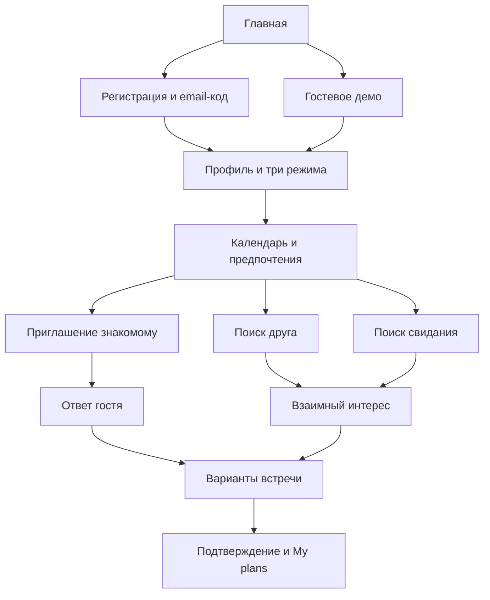
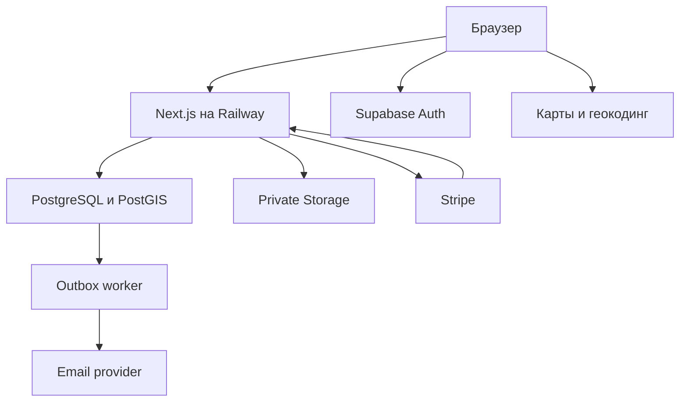

# BothFree — полная архитектура продукта и план реализации

> Версия спецификации: 1.1 · 14 ноября 2026 года.
> Статус: проектное техническое задание для будущей реализации. Этот README не означает, что сайт уже разработан, протестирован или опубликован.
> Основной язык интерфейса: английский (US). Язык документации: русский.
> Размещение: Railway — Next.js-приложение; Supabase — Auth, PostgreSQL/PostGIS и Storage.

## Содержание

1. [Продукт и требования чемпионата](#1-продукт-и-требования-чемпионата)
2. [Сценарии и роли](#2-сценарии-и-роли)
3. [Регистрация, гендер и инклюзивность](#3-регистрация-гендер-и-инклюзивность)
4. [Карта страниц](#4-карта-страниц)
5. [Подробное описание экранов](#5-подробное-описание-экранов)
6. [Дизайн и доступность](#6-дизайн-и-доступность)
7. [Системная архитектура](#7-системная-архитектура)
8. [Структура репозитория](#8-структура-репозитория)
9. [Модель данных](#9-модель-данных)
10. [Доступ и RLS](#10-доступ-и-rls)
11. [Алгоритм подбора](#11-алгоритм-подбора)
12. [Состояния, транзакции и календарь](#12-состояния-транзакции-и-календарь)
13. [API и контракты](#13-api-и-контракты)
14. [Подписка и бизнес-модель](#14-подписка-и-бизнес-модель)
15. [Демо для жюри](#15-демо-для-жюри)
16. [Безопасность и модерация](#16-безопасность-и-модерация)
17. [Настройка Supabase](#17-настройка-supabase)
18. [Локальный запуск](#18-локальный-запуск)
19. [Размещение на Railway](#19-размещение-на-railway)
20. [Этапы реализации](#20-этапы-реализации)
21. [Проверки и критерии готовности](#21-проверки-и-критерии-готовности)
22. [Метрики и защита](#22-метрики-и-защита)
23. [Ограничения и следующие версии](#23-ограничения-и-следующие-версии)
24. [Официальные технические источники](#24-официальные-технические-источники)

## 1. Продукт и требования чемпионата

### 1.1. Обещание продукта

**BothFree turns “We should meet” into a plan on the calendar.**

Сервис помогает взрослым 25–45 лет в США согласовать встречу со знакомыми, найти новых друзей или познакомиться для свидания. Основа — пересечение свободного времени, интересов, территории и комфортного бюджета. ИИ в продукте не используется: расчёты детерминированы, критерии понятны пользователю.

Трек чемпионата: **Entertainment**. Пользователь покупает возможность эффективнее находить людей для совместного досуга. Ценность должна проявляться в согласованной встрече, а не только в просмотре анкет.

### 1.2. Три стартовых выбора

1. **Invite someone I know** — пригласить знакомого человека или компанию по ссылке.
2. **Find a new friend** — найти нового друга для совместного занятия.
3. **Find a date** — познакомиться для свидания.

Друг и свидание — разные намерения. Сервис не переводит дружеский интерес в романтический автоматически. Одинаковый человек может включить оба режима, но карточки, лайки и совпадения всегда имеют явный тип.

### 1.3. Соответствие правилам

| Требование | Решение |
| --- | --- |
| B2C, США, 25–45 | Продукт для частных пользователей; стартовый город — New York; доступ 18+, маркетинговый сегмент 25–45 |
| Веб-продукт | Адаптивный браузерный интерфейс; отдельное мобильное приложение не нужно |
| Основная ценность реальная | Два разных браузера вводят данные; сервер действительно вычисляет пересечения и сохраняет подтверждения |
| Без регистрации для жюри | Отдельный рабочий демо-контур; гостевой ответ на обычное приглашение также без аккаунта |
| Публичный репозиторий | Исходники, миграции, примеры переменных без секретов, инструкция воспроизведения |
| До 10 слайдов | Отдельная презентация с проблемой, демо, экономикой и ограничениями |
| 40/20/15/15/10 | Приоритет рабочему сценарию; ценность/удержание; аудитория; бизнес; отличие |

### 1.4. Границы первой версии

**MVP:** регистрация + код, инклюзивный профиль, три режима, пошаговые предпочтения, карта с полигоном, реальные приглашения, подбор зарегистрированных пользователей, взаимные лайки, согласование плана, календарный экспорт, блокировка/жалоба, базовая модерация, демо без аккаунта.

**Premium:** экран $14.99/месяц и права доступа. Реальные деньги подключаются только после полной тестовой интеграции. Если платежи не готовы к защите — явно показывать Test mode, не имитировать покупку как успешное списание.

**Следующие версии:** Google Calendar sync, автоматические бронирования, большие групповые поиски, сложные повторяющиеся расписания, несколько городов, пуши.

## 2. Сценарии и роли

### 2.1. Роли

| Роль | Возможности |
| --- | --- |
| Посетитель | Главная, тариф, документы, запуск демо, минимальное превью приглашения |
| Гость по ссылке | Создать временную сессию, ответить на одно приглашение, видеть разрешённый итог этой встречи |
| Зарегистрированный пользователь | Настройки, личные встречи и приглашения; после подтверждения почты — discovery и лайки |
| Premium-пользователь | Расширенные dating-возможности; безопасность не зависит от оплаты |
| Demo-пользователь | Реальные действия только в изолированной демо-комнате |
| Модератор | Ограниченный доступ к жалобам и необходимым материалам |
| Администратор | Операции поддержки; отдельные серверные полномочия с аудитом |

Не хранить роль администратора или Premium в редактируемом клиентом `user_metadata`.

### 2.2. Знакомый

Создать аккаунт → подтвердить email → выбрать Invite → отметить даты и время → занятие → район → бюджет → проверить → создать ссылку → гость отвечает → сервер считает варианты → участники подтверждают один вариант → встреча попадает в My plans → скачать `.ics`.

Ссылка сама по себе не раскрывает расписание создателя. До вступления доступны только безопасное название, имя организатора и срок действия.

### 2.3. Новый друг

Аккаунт → email → профиль → Friends → предпочтения + разделение счёта → карточки доступных людей → взаимный интерес типа friendship → предложение встречи → согласие обеих сторон.

Пол и ориентация не используются для романтических выводов в режиме Friends. Географию, свободное время и интересы учитываем. Гендерный фильтр дружбы откладываем: для MVP по умолчанию все гендеры.

### 2.4. Свидание

Аккаунт → email → профиль → Date → явно выбрать, кого хочется встретить, и возрастной диапазон → предпочтения → карточки → взаимный лайк типа dating → варианты → подтверждение.

Взаимный лайк означает интерес к знакомству, а не согласие на встречу, оплату, передачу контактов или физическую близость.

### 2.5. Компания друзей

Один организатор и до 8 участников в MVP. Основной режим ищет пересечение для **всех**. Если такого времени нет, отдельная вкладка показывает частичные варианты с явным числом участников. Нельзя подписывать частичный вариант как “Everyone is free”.

## 3. Регистрация, гендер и инклюзивность

### 3.1. Регистрационная форма

Поля из согласованного запроса:

| Поле | Обязательность | Хранение и поведение |
| --- | --- | --- |
| Имя | Да | Публично только выбранное имя; 1–60 символов, Unicode |
| Email | Да | Supabase Auth; публичным не становится |
| Дата рождения | Да | Приватно; проверка 18+ сервером; в карточке только возраст |
| Пароль | Да | Только Supabase Auth; не сохранять в таблицах приложения или логах |
| Телефон | Да | Формат E.164; приватно; без SMS-проверки статус `unverified` |
| Пол / гендер | Да, с вариантом не раскрывать | Явный вопрос “How do you describe your gender?”; не выводить из имени или фотографии |
| Условия и privacy | Да | Версия документов + время согласия |
| Маркетинговые письма | Нет | Отдельный, изначально выключенный выбор |

Вместо неподходящего “Your sex?” используем понятное “Your gender”. Биологический пол при рождении для этой функции не нужен и не собирается.

### 3.2. Ответы на вопрос о гендере

Базовые варианты: **Woman, Man, Non-binary, Self-describe, Prefer not to say**. Допускается выбрать несколько идентичностей, кроме взаимоисключающего Prefer not to say. У Self-describe — короткое собственное описание.

Дополнительно, необязательно:

- Pronouns: she/her, he/him, they/them, self-describe, prefer not to say.
- Show gender on my profile — по умолчанию выключено.
- Show pronouns on my profile — отдельный переключатель.
- Sexual orientation — необязательное поле: straight, gay, lesbian, bisexual, pansexual, asexual, queer, questioning, self-describe, prefer not to say; можно несколько, кроме последнего.
- Show orientation — по умолчанию выключено.

Транс-женщина выбирает Woman, транс-мужчина — Man; не требовать выделять трансгендерность отдельной обязательной категорией. Не добавлять фильтр “cis/trans”. Ориентацию нельзя вычислять по выбранным гендерам партнёров.

### 3.3. Dating-предпочтения

Отдельный вопрос: **“Who would you like to meet?”**

- Women.
- Men.
- Non-binary people.
- Everyone.
- Open to other self-described identities.

Разрешён множественный выбор. Everyone означает отсутствие ограничения по гендеру. Возрастной диапазон включает обе границы и всегда >=18. Предпочтения приватны и не возвращаются в discovery DTO.

Для собственного описания идентичности пользователь по желанию выбирает стандартные категории, по которым его можно находить (`discovery_gender_tags`). Это добровольная классификация для поиска, не публичный ярлык. Не анализировать свободный текст для автоматической классификации.

Если пользователь не хочет раскрывать гендер даже алгоритму, он может участвовать в Friends/Invite. В Date он находится только теми, кто выбрал Everyone; система не угадывает пол. Этот эффект объяснить до включения dating-профиля. Фильтрация взаимная: предпочтения A допускают B и предпочтения B допускают A.

### 3.4. Email-код

Регистрация: `supabase.auth.signUp` с email/password. Шаблон **Confirm signup** должен содержать `{{ .Token }}`, чтобы пользователь получил вводимый код. Экран `/verify-email` вызывает поддерживаемый текущим SDK `verifyOtp({ email, token, type: 'email' })`; проверить на выбранной версии SDK в staging. Не смешивать эту операцию с незапрошенным повторным созданием пользователя через passwordless-signup.

Повторная отправка — операция resend для signup; TTL и период ожидания согласованы с настройками Supabase. Код одноразовый; неверный и истёкший код имеют разные понятные сообщения без раскрытия существования чужих аккаунтов. После подтверждения получить сессию и записать приватный профиль сервером. Временный пароль не хранить в localStorage или промежуточной таблице.

Для незавершённой регистрации допустим краткоживущий server-side draft, связанный с Auth user id; доступ к нему только владельцу, автоматическая очистка. До подтверждения email профиль не участвует в поиске.

Email verification не означает подтверждённый телефон, подтверждённую личность или проверенную дату рождения.

## 4. Карта страниц



### 4.1. Маршруты

| URL | Доступ | Назначение |
| --- | --- | --- |
| `/` | Все | Landing, три сценария, CTA и demo |
| `/signup`, `/login` | Все | Регистрация / вход |
| `/verify-email` | Незавершённая регистрация | Код и resend |
| `/forgot-password`, `/reset-password`, `/auth/confirm` | По потоку Auth | Восстановление, callback |
| `/onboarding/profile` | Владелец аккаунта | Фото, гендер, pronouns, bio, интересы |
| `/app` | Сессия | Выбор трёх режимов |
| `/app/requests/new` | Сессия | Создание draft; параметр mode из allowlist |
| `/app/requests/[id]/when` | Владелец | Период и доступность |
| `/app/requests/[id]/activities` | Владелец | Занятия |
| `/app/requests/[id]/area` | Владелец | Карта и область |
| `/app/requests/[id]/budget` | Владелец | Лимит и bill preference |
| `/app/requests/[id]/review` | Владелец | Итог перед публикацией |
| `/app/invitations/[id]` | Организатор/участник | Состояние приглашения |
| `/invite/[token]` | Получатель ссылки | Минимальное превью; token обменять на capability |
| `/invite/respond/[id]` | Гостевая capability | Собственная анкета гостя |
| `/app/discover/friends` | Verified full user | Дружеские карточки |
| `/app/discover/dates` | Verified full user | Dating-карточки |
| `/app/matches` | Владелец | Список взаимных совпадений |
| `/app/matches/[id]` | Участник | Планирование и сообщения |
| `/app/plans` | Владелец | Список своих встреч |
| `/app/plans/[id]` | Участник/capability | Детали, подтверждение, отмена |
| `/app/settings` | Владелец | Аккаунт, privacy, режимы, блокировки, удаление |
| `/premium` | Все | Предложение и цена |
| `/app/billing` | Владелец full account | Подписка и портал оплаты |
| `/demo`, `/demo/join/[token]` | Все 18+ | Изолированная рабочая комната без signup |
| `/admin/reports` | Модератор | Жалобы и решения |
| `/privacy`, `/terms`, `/community`, `/help` | Все | Документы и помощь |

Группа маршрутов Next.js `(app)` не должна случайно дублировать `/app`: URL формируется файловым путём, а не названием route group.

## 5. Подробное описание экранов

### 5.1. Главная

Навигация: логотип BothFree, How it works, Premium, Log in. Первый экран: короткий заголовок, объяснение и две CTA — Get started и Try without signing up. Ниже три карточки режимов, три шага работы, небольшой блок приватности, footer.

Не показывать вымышленные отзывы, “10,000 dates booked” или количество онлайн-пользователей. Если данных нет — секцию не добавлять.

### 5.2. Регистрация и вход

Форма регистрации разбита визуально на Contact и About you, но отправляется согласованно. Валидация рядом с полями, пароль можно показать/скрыть, номер вводится с кодом страны. Для даты рождения нет заранее установленной подходящей даты. Отказ пользователям младше 18 без создания публичного профиля.

Login: email/password, Forgot password, сохранение только разрешённого внутреннего `returnTo`. Проверять redirect на сервере; нельзя редиректить на произвольный внешний домен. Успешный вход возвращает к незавершённому шагу.

### 5.3. Подтверждение email

Одно поле с `autocomplete="one-time-code"`, `inputmode="numeric"`, длина по настройке OTP (в целевом UX — 6 цифр). Показывать замаскированную почту, Change email, Resend с countdown, Loading и Error. Вставка всего кода работает. Не делать шесть недоступных для клавиатуры отдельных полей.

### 5.4. Профиль

Имя и возраст, 1–4 фотографии, bio до 300 символов, интересы, гендер и переключатели видимости. Фото обязательно для публичного discovery после модерационного допуска, но не для приглашений знакомым. Отдельные тумблеры Available for friends / Available for dating.

Настройки знакомства запрашиваются только при включении Date. Изменение гендера, возраста/предпочтений или режима скрывает несовместимые будущие рекомендации, но не переписывает историю уже состоявшихся встреч.

### 5.5. Выбор режима

Три равные карточки, каждая с конкретной подписью. Выбор создаёт draft запроса на сервере. Переключение режима не теряет календарь и общие предпочтения; type-specific поля запрашиваются заново. Не активировать dating невидимым default.

### 5.6. Календарь: период, интервалы и длительность

Сначала период `date_from` / `date_to` (MVP: до 14 дней), затем week grid со свободными окнами. Desktop — drag-select с шагом 30 минут; mobile и keyboard — список дат + Add interval с From/Until. Несколько окон в день. Можно удалить и скопировать окно на выбранные дни.

Поля: IANA timezone, meeting duration (30/60/90/120 min), необязательный buffer (0/15/30 min). Автоопределённую зону показывать и разрешать изменить. Выделенные окна обозначать и цветом, и подписью Free. Пересекающиеся окна объединяются сервером. Пример: 18:00–19:00 и 18:30–20:00 → одно окно 18:00–20:00.

Не выдавать весь блок доступности за длительность встречи: из окна 18:00–22:00 можно выбрать часовую встречу. Если человек свободен 30 минут, 60-минутный вариант не предлагается.

### 5.7. Занятия

Каталог: Coffee, Walk, Dinner, Museum, Board games, Live music, Other. Множественный выбор; минимум один. В MVP Other требует короткого описания и ручного согласования; не считать разные произвольные описания совпадением автоматически. Опциональные свойства: indoor/outdoor, alcohol-free, wheelchair-accessible — только как пользовательские требования; не обещать доступность места без проверки.

### 5.8. Карта

Город/район с поиском, Use my location, Draw area, Edit, Clear. Геолокация запрашивается только по нажатию. Точный GPS используется для центрирования; не сохраняется как домашняя точка. Пользователь очерчивает допустимую территорию встречи полигоном, а не маршрут движения.

Desktop: добавить точки и завершить полигон. Mobile: касания с явной Finish area; запасной режим — центр+радиус или готовый район. Геометрия должна проходить серверную проверку, включая координаты, самопересечения, максимум 100 вершин, предел площади и территорию поддерживаемого города.

Для карт использовать MapLibre GL JS, совместимый редактор полигонов (например Terra Draw после проверки актуального адаптера) и провайдера тайлов/геокодинга с подходящими условиями. MapLibre сам по себе не предоставляет бесплатный неограниченный каталог карт или мест. Атрибуция обязательна; не использовать публичный OSM tile server как неограниченный production backend.

Если GPS запрещён — поиск района остаётся доступен. Если карты не загрузились — ручной район и понятное сообщение; не сохранять пустой полигон как весь город.

### 5.9. Бюджет

Показывать USD **на одного человека за одну встречу**, не общий бюджет всей группы. В базе — целые центы. Выбор “Free” означает ceiling=0. Для платных форматов ввод максимума, например Up to $20 / $40 / $75, и необязательный minimum=0.

Пользователь указывает максимально комфортную **полную стоимость своего участия**, включая ожидаемые дополнительные платежи. Оценки заведений помечаются Approximate; не гарантировать итоговый счёт.

В Friends/Date дополнительный вопрос: Each pays their own / Split equally / I’d like to treat / Discuss together. Для приглашения знакомому этот вопрос не обязателен, но можно открыть в расширенных настройках.

“I’d like to treat” — добровольное предпочтение, не основание показать дорогой вариант выше чужого лимита без обсуждения. В MVP общий расчёт консервативен по per-person ceiling; изменение распределения и общего лимита подтверждается отдельно. Несовпадение способов оплаты даёт статус Needs discussion, а не невидимое принятие.

### 5.10. Review

Сводка: режим, даты/таймзона, окна, длительность, занятия, территория, бюджет, предпочтение счёта. Edit у каждого блока. CTA для знакомого Create invitation; для нового человека Start exploring. Обязательные незаполненные поля блокируют публикацию, но не сохранение draft.

### 5.11. Приглашение знакомому

Create private link, Copy, Share через Web Share при поддержке, revoke, срок действия. У single-person ссылки — один гостевой claim, у group ссылки — явный лимит участников. Нельзя повторным claim того же браузера создать несколько участников.

Получатель видит “Alex invited you to make a plan”, выбирает имя и подтверждает 18+, создаёт временную сессию и заполняет те же шаги. Signup не требуется. Доступ к изменениям держится на capability, а не на знании invitation id. Предлагать сохранить аккаунт после результата, не блокировать завершение.

### 5.12. Discovery Friends / Dates

Переключение режима заметно, карточки не смешиваются. Карточка: фотографии, имя, возраст, bio, интересы, грубая территория, подпись “Shared time available”. Точный общий слот раскрывать после взаимного интереса; сырые окна не раскрываются.

Управление: Like / Pass, View profile, Report, Block. Доступная альтернатива swipe; каждый Like проверяется на сервере. Пустая выдача показывает реальную причину в общих терминах: расширить даты, территорию, занятия. Нельзя показывать закрытых, несовершеннолетних, заблокированных или вымышленных людей как реальных.

### 5.13. Match и общий план

Взаимный лайк создаёт один match в конкретном режиме. На странице — до трёх настоящих вариантов: дата, обе локальные таймзоны при различии, длительность, общее занятие, общая территория и допустимый бюджет. Обозначить, что venue не забронирован.

Участник выбирает предложение; другой подтверждает тот же proposal version. При изменении существенных условий согласия сбрасываются. Chat доступен только участникам и закрывается для новых сообщений после block.

### 5.14. My plans

Upcoming / Waiting / Past / Cancelled. Карточка показывает статус, людей, время, формат. Действия: открыть, подтвердить, перепланировать, отменить, скачать ICS. Пропущенное подтверждение не обозначается как confirmed. После окончания — опциональный вопрос Did you meet?; ответы приватны, не публиковать оценки человека автоматически.

### 5.15. Premium и billing

Цена, что включено, период оплаты, отмена, отсутствие гарантии встречи. Полный поток Checkout → webhook → entitlement → Premium UI. Страница возврата из Checkout не выдаёт Premium сама. Test mode всегда подписан. Billing portal доступен владельцу подписки. При отмене в конце периода Premium действует до конца оплаченного срока; дальнейшие встречи и сообщения не пропадают из-за отмены.

### 5.16. Settings и moderation

Изменить профиль; email через Auth; password recovery; телефон; privacy; pause friends; pause dates; blocked users; уведомления; billing; export/delete account. Модератор видит очередь жалоб, статус, минимальные доказательства, действия и журнал решений. Полномочия проверяются сервером, а не отсутствием ссылки в меню.

## 6. Дизайн и доступность

Визуальная система: спокойный светлый фон, тёмный зелёный основной цвет, мягкие карточки, небольшие акценты. Dating не выделяется стереотипными розовыми/голубыми цветами по полу. Фото людей — с разрешением; демо-профили явно вымышленные.

Компоненты: AppShell, ModeCard, Stepper, AvailabilityGrid, IntervalEditor, ActivityPicker, AreaMap, BudgetInput, BillPreference, ProfileCard, SharedPlanCard, StatusBadge, InviteLinkPanel, UpgradeSheet, EmptyState, ErrorState.

Desktop: header + sidebar + рабочая область. Mobile: нижняя навигация Discover / Plans / Profile и видимая текущая mode. На signup sidebar не нужен. Не делать два разных checkout/планировщика для мобильной и desktop-версии.

Состояния каждого экрана: Loading, Empty, Error, Success, Disabled с объяснением. Все формы имеют label, доступную ошибку, keyboard focus, touch target около 44px. Проверять контраст и ширины 360/768/1440. Карта не должна быть единственным способом выбрать территорию; календарь не требует мыши. Интерфейс не использует цвет как единственный признак.

## 7. Системная архитектура

### 7.1. Выбранный стек

| Слой | Решение | Причина |
| --- | --- | --- |
| Web | Next.js App Router + TypeScript | Страницы и backend в одном приложении |
| UI | React, Tailwind CSS, Radix/shadcn-подобные компоненты | Быстрое создание доступного интерфейса |
| Формы | React Hook Form + Zod | Одинаковые правила на клиенте и сервере |
| Auth | Supabase Auth + `@supabase/ssr` | Password/email, cookie sessions, guest sessions |
| База | Supabase PostgreSQL + PostGIS | Транзакции, пространственный поиск, ограничения |
| Файлы | Supabase Storage, private buckets | Фото через разрешённый доступ |
| Карты | MapLibre + tile/geocoding provider | Полигон и интерактивная карта |
| Email | Supabase custom SMTP для Auth; SMTP/provider для транзакционных уведомлений | Реальная доставка кода и уведомлений |
| Оплата | Stripe Checkout + Billing Portal + webhooks | Подписка при доступности аккаунта у команды |
| Размещение | Railway Node service | Один сервер приложения |
| Фоновые задачи | Supabase Cron + outbox worker | Очистка, истечения, уведомления |
| Тесты | Vitest, Playwright, SQL/RLS integration | Проверка алгоритма и межпользовательского доступа |

Использовать поддерживаемые стабильные версии на момент начала реализации, закрепить их в lockfile и Node version. Этот документ не предписывает неподтверждённые номера версий.

### 7.2. Границы сервисов



Браузер работает напрямую с Auth, но не получает доступ к чужим приватным таблицам. API приложения возвращает строго ограниченные DTO. Административные ключи — только на Railway и в доверенных jobs. Пароли не проходят через собственную бизнес-таблицу.

Для транзакционных операций — ограниченные PostgreSQL RPC, вызываемые сервером с JWT пользователя. Функция проверяет `auth.uid()`, роль/сессию, room и membership. `SECURITY DEFINER` допускается только для необходимой операции, с фиксированным `search_path`, квалифицированными именами, минимальными привилегиями и явными GRANT; не давать универсальный произвольный SQL RPC.

Private schema не публикуется в Data API. Таблицы, которые действительно экспонируются, защищаются RLS. Не использовать широкое `SELECT *` из таблицы профилей с приватными колонками. Все private DTO формирует backend/RPC после проверки доступа.

### 7.3. Работа без Redis на старте

Одна Railway service, rate-limit counters в PostgreSQL, транзакции там же. Это проще для MVP, чем отдельные микросервисы. При нескольких экземплярах приложения counters должны оставаться общими: in-memory limiter недостаточен. WebSocket-сервер не обязателен: MVP использует polling после записи или разрешённые приватные Realtime channels.

### 7.4. Производительность

Discovery сначала фильтрует по room/mode/status/городам/возрасту, потом по доступности и геометрии; не считать точные полигоны для всей базы. Кандидаты выдаются курсором, например по 20. Временные окна ограничены 14 днями; серверная выдача до 3 plan proposals. Профили и личные API `private, no-store`; не кэшировать пользовательские ответы в общем CDN.

## 8. Структура репозитория

```text
bothfree/
  README.md
  package.json
  package-lock.json
  .env.example
  .gitignore
  Dockerfile
  railway.json
  next.config.ts
  src/
    app/
      page.tsx
      (auth)/signup/page.tsx
      (auth)/login/page.tsx
      (auth)/verify-email/page.tsx
      (auth)/forgot-password/page.tsx
      (auth)/reset-password/page.tsx
      auth/confirm/route.ts
      app/
        layout.tsx
        page.tsx
        requests/[id]/[step]/page.tsx
        discover/[mode]/page.tsx
        invitations/[id]/page.tsx
        matches/[id]/page.tsx
        plans/[id]/page.tsx
        settings/page.tsx
        billing/page.tsx
      invite/[token]/page.tsx
      invite/respond/[id]/page.tsx
      demo/page.tsx
      demo/join/[token]/page.tsx
      premium/page.tsx
      admin/reports/page.tsx
      api/
        health/route.ts
        ready/route.ts
        v1/.../route.ts
        webhooks/stripe/route.ts
    components/
      ui/
      auth/
      onboarding/
      calendar/
      map/
      discovery/
      plans/
      billing/
    lib/
      supabase/{browser,server,admin}.ts
      auth/{guards,guest-capabilities}.ts
      matching/{time,geo,budget,gender,rank,proposals}.ts
      billing/{stripe,entitlements}.ts
      security/{rate-limit,csrf,redaction}.ts
      calendar/ics.ts
      notifications/outbox.ts
      validation/
      types/database.ts
  supabase/
    config.toml
    migrations/
    seed.sql
    tests/
  tests/
    unit/
    integration/
    e2e/
  scripts/
    seed-demo.ts
    cleanup-demo.ts
```

Структура — целевая, файлов реализации пока нет. Auth refresh boundary (`proxy.ts` или `middleware.ts`) выбирается по установленной версии Next.js и актуальному примеру Supabase. Не создавать оба варианта одновременно.

## 9. Модель данных

### 9.1. Соглашения

UUID PK; все timestamps `timestamptz`, время создания серверное. День рождения `date`. Стоимость — `integer` в центах, currency=`USD`. Геометрия SRID 4326. Enum фиксируют допустимые состояния. Все FK, unique, check constraints создаются миграциями.

`room_id` — обязательная область данных. Production rows имеют отдельную production room; demo room — собственный UUID и `expires_at`. Demo никогда не участвует в production-discovery. Room id передаётся сервером из сессии, а не доверяется из body.

В таблицах ниже `private` означает неэкспонируемую схему; в публичных API доступны только описанные DTO. Права на schema и functions выдаются отдельно. Для пользователя Auth id — единственный источник идентичности.

### 9.2. Профили

| Таблица | Ключевые поля | Ограничения |
| --- | --- | --- |
| `private.account_details` | user_id FK auth.users, date_of_birth, phone_e164, phone_verified_at, country, terms_version, privacy_version, accepted_at | PK user_id; date_of_birth не в будущем; 18+ при активации discovery; телефон не публичный |
| `private.profiles` | user_id, room_id, display_name, bio, city_id, friendship_enabled, dating_enabled, discovery_status, paused_at, deleted_at | UNIQUE(room_id,user_id); status draft/active/paused/suspended |
| `private.profile_identity` | user_id, gender_codes[], gender_custom, pronouns, orientation_codes[], visibility flags, discovery_gender_tags[] | Самоописания ограничены по длине; prefer_not_to_say не с другими значениями |
| `private.dating_preferences` | user_id, min_age, max_age, accepted_gender_tags[], accepts_everyone, accepts_custom_identities | min_age>=18, max_age>=min_age; отсутствующее значение не означает everyone |
| `private.profile_photos` | id, user_id, storage_path, sort_order, moderation_status, created_at | UNIQUE(user_id,sort_order); approved требуется для discovery |
| `private.profile_interests` | user_id, activity_id | Составной PK |
| `public.activities` | id, code, label, active | Общедоступный справочник, запись только admin |
| `public.cities` | id, name, country, timezone, boundary | Общедоступный справочник поддерживаемых территорий |

Email остаётся в Auth; не дублировать без необходимости. Публичная карточка — не отдельная незащищённая таблица; это проекция разрешённых полей.

### 9.3. Предпочтения конкретного поиска

| Таблица | Поля | Ограничения |
| --- | --- | --- |
| `private.meeting_requests` | id, room_id, owner_id, mode, status, date_from/date_to, timezone, duration_minutes, buffer_minutes, city_id, min/max_budget_cents, bill_preference, preference_version | mode invite/friendship/dating; max>=min>=0; duration allowlist; период<=14 дней |
| `private.availability_windows` | id, request_id, starts_at, ends_at | starts_at<ends_at; интервал в заданном периоде; нормализация пересечений |
| `private.request_activities` | request_id, activity_id | UNIQUE(request_id,activity_id) |
| `private.request_areas` | request_id, area geometry(MultiPolygon,4326), source, area_label | Одна область; валидная геометрия; bbox и число вершин ограничены |

Поиск имеет одну активную заявку на пользователя/режим/room в MVP; partial unique index для active. Новый draft допустим, но активировать его надо транзакционно с архивированием предыдущего. Friend и dating могут иметь разное свободное время и бюджет.

### 9.4. Приглашения и гостевой доступ

| Таблица | Поля | Ограничения |
| --- | --- | --- |
| `private.invitations` | id, room_id, owner_id, request_id, token_hash, max_guests, expires_at, revoked_at, title | token_hash UNIQUE; raw token не хранить; max_guests 1–7 |
| `private.invitation_members` | id, invitation_id, user_id, role, guest_request_id, joined_at, left_at | UNIQUE(invitation_id,user_id); owner/guest; до capacity |
| `private.guest_capabilities` | id, invitation_id, user_id, secret_hash, expires_at, revoked_at | Только server-side redeem; bound to auth session; не отдавать secret_hash |
| `private.demo_rooms` | id, owner_session_id, join_token_hash, expires_at, created_at | Отдельная область и автоматическая очистка |

Гость получает анонимного Supabase Auth user через `signInAnonymously`, но это техническая сессия без email/signup-формы. Получатель проходит 18+ подтверждение; публичный discovery для анонимных пользователей запрещён. Потеря гостевой сессии не восстанавливается через угадываемый id; для восстановления требуется защищённая recovery-ссылка или аккаунт.

### 9.5. Discovery и встречи

| Таблица | Поля | Ограничения |
| --- | --- | --- |
| `private.likes` | id, room_id, from_user_id, to_user_id, mode, decision, created_at | UNIQUE(room_id,from,to,mode); from!=to; like/pass |
| `private.matches` | id, room_id, user_low_id, user_high_id, mode, status, created_at | UNIQUE(room_id,low,high,mode); low<high; обе стороны допустимы |
| `private.plans` | id, room_id, match_id nullable, invitation_id nullable, status, version, selected_proposal_id nullable | Ровно один источник match или invitation |
| `private.plan_members` | plan_id, user_id, role, participation_status | UNIQUE(plan_id,user_id); invited/active/declined/left |
| `private.plan_proposals` | id, plan_id, version, starts_at, ends_at, timezone, activity_id, common_area, budget_ceiling_cents, bill_status, venue_id nullable, expires_at, input_versions jsonb | starts<ends; version соответствует plan; provenance входных заявок |
| `private.plan_acceptances` | plan_id, proposal_id, proposal_version, user_id, accepted_at | UNIQUE(plan_id,user_id); FK proposal принадлежит plan |
| `private.messages` | id, plan_id, sender_id, body, created_at, removed_at | Только active members; лимит текста; plain text |
| `private.confirmed_bookings` | id, plan_id, user_id, busy_range tstzrange, released_at | Частичное exclusion по user_id и overlap для active rows; btree_gist |
| `public.venues` | id, city_id, name, point geography(Point,4326), activity_id, estimated_cost_cents, source_url, checked_at, is_active | Только проверенные источники; цена оценочная; не выдумывать availability |

`confirmed_bookings` означает внутреннюю занятость человека в BothFree, а не бронь заведения. На одного участника создавать одну запись, busy_range включает agreed buffer.

### 9.6. Подписка, модерация, уведомления

| Таблица | Поля |
| --- | --- |
| `private.billing_customers` | user_id UNIQUE, stripe_customer_id UNIQUE |
| `private.subscriptions` | stripe_subscription_id UNIQUE, user_id, price_id, status, current_period_end, cancel_at_period_end, synced_at |
| `private.billing_events` | stripe_event_id UNIQUE, status pending/processed/failed, received_at, processed_at, error_code |
| `private.entitlements` | user_id, feature_code, valid_until, source, updated_at; UNIQUE(user_id,feature_code,source) |
| `private.blocks` | blocker_id, blocked_id, created_at; UNIQUE pair, no self |
| `private.reports` | id, reporter_id, subject_id, plan_id nullable, reason, details, status, assigned_to, created_at |
| `private.moderation_actions` | id, actor_id, subject_id, action, reason, created_at |
| `private.notifications` | id, user_id, kind, object_id, read_at, created_at |
| `private.outbox` | id, dedupe_key UNIQUE, kind, payload_minimal, status, attempts, next_attempt_at |
| `private.audit_log` | actor_id, action, object_type, object_id, request_id, created_at; без секретов |
| `private.rate_limit_buckets` | key_hash, window_start, count, expires_at |

### 9.7. Индексы и ограничения

- B-tree: owner_id, membership user_id, room/status/mode/city, plan_id+created_at для сообщений.
- GiST: request areas, venue points и временные диапазоны там, где реально используются range operators.
- `btree_gist` для exclusion user_id + tstzrange.
- Уникальность лайков, match pair, webhook events, принятия proposal, повторного guest claim.
- FK с продуманным ON DELETE; не каскадировать платёжные записи без retention-решения.
- Каждый индекс проверяется EXPLAIN на тестовом объёме; не создавать дубли «на всякий случай».

## 10. Доступ и RLS

### 10.1. Общий принцип

UI не является границей безопасности. Каждый endpoint и каждая RPC проверяют пользователя, room, ownership/membership, блокировки и допустимость перехода состояния. Клиент не задаёт `owner_id`, `sender_id`, admin role или Premium.

| Данные | Владелец | Другой участник | Незнакомый пользователь | Backend/moderator |
| --- | --- | --- | --- | --- |
| Email, телефон, DOB | Свои разрешённые данные | Нет | Нет | По служебной необходимости |
| Гендер и ориентация | Свои | Только включённые публичные поля | Только разрешённый discovery DTO | Matching — только нужные поля |
| Полное расписание/полигон/бюджет | Свои | Нет | Нет | Вычисление на сервере |
| Общие варианты встречи | Да | Да, если участник | Нет | Да |
| Входящие лайки | Серверная проверка Premium | Нет | Нет | Да |
| Сообщения | В своей встрече | В своей встрече | Нет | Только при жалобе/служебном основании |
| Subscription | Свой статус | Нет | Нет | Изменение только billing handler |
| Reports | Создание/статус своей жалобы | Нет | Нет | Назначенный moderator |

Supabase RLS обязателен для экспонируемых таблиц и Storage policies. Неэкспонируемые private tables дополнительно закрыты schema grants; основной доступ через ограниченные RPC. Пример owner-only policy не заменяет полноценную матрицу политик:

```sql
-- Пример для owner-only таблицы, если она экспонируется.
-- Не готовая миграция всей системы.
alter table public.example_user_drafts enable row level security;
create policy own_drafts on public.example_user_drafts
for all to authenticated
using (owner_id = (select auth.uid()))
with check (owner_id = (select auth.uid()));
```

Анонимный Auth user имеет authenticated role, поэтому одной проверки роли недостаточно: проверять `is_anonymous`, capability и demo room. Публичный anon API key и anonymous Auth session — разные вещи.

Realtime, если включён, использует те же membership/block guards и приватные каналы. Не включать всю private schema в широкую публичную репликацию. Для MVP polling предпочтительнее, если корректные policies ещё не готовы.

### 10.2. Секретные ссылки

Генерировать не менее 32 random bytes; хранить SHA-256 hash. HTTPS-only. Токен из URL обменивается POST-запросом на защищённую capability cookie/session, после чего redirect убирает token из адресной строки. Не делать state-changing claim по GET: почтовые сканеры могут открывать ссылки автоматически.

На invite-route `Referrer-Policy: no-referrer`, `Cache-Control: no-store`, без сторонней аналитики; токен редактируется из access logs. Ссылка не даёт доступ ко всем встречам владельца. Revoke отзывает не только link, но и связанные guest capabilities согласно выбранному действию; UI показывает, что уже вошедшие гости потеряют доступ.

### 10.3. Storage

Фото — private bucket `profile-photos`. Upload path начинается с собственного user_id, сервер ограничивает размер (например 5 MB), количество и MIME. Проверять реальный формат, убирать EXIF, не принимать SVG/HTML как фото. Private оригинал не выдавать напрямую. Предпросмотр — короткоживущий signed URL только для разрешённого зрителя или защищённый image proxy.

После block новые URL не выдаются. Уже выданный signed URL действует до TTL, поэтому TTL короткий; немедленный отзыв требует proxy. Оригинальные GPS метаданные не сохранять в публичной версии.

## 11. Алгоритм подбора

### 11.1. Обязательные фильтры

1. Одинаковый room и mode, активная анкета и активный запрос.
2. Оба 18+, подтверждённый email для production discovery, одобренное фото.
3. Не тот же пользователь; нет block в любом направлении; нет suspension.
4. Для Date — взаимный возрастной и гендерный фильтр. Не фильтровать по угаданной ориентации.
5. Есть общий временной интервал достаточной длительности.
6. Есть хотя бы одно общее занятие.
7. Территории имеют допустимое непустое пересечение.
8. Бюджет допускает выбранное занятие; способ счёта совместим или явно Needs discussion.

Клиент не получает сведения, какой конкретный скрытый фильтр другого человека его исключил.

### 11.2. Время

Ввод локального времени + IANA timezone преобразуется в UTC. В БД — полуоткрытые интервалы `[start,end)`. Несуществующее время при переходе DST не принимается молча; при неоднозначном времени пользователь уточняет offset. Сдвиг времени зоны учитывается timezone-библиотекой, а не фиксированным UTC-5.

Для двух людей:

```text
start = max(A.start, B.start)
end   = min(A.end, B.end)
fits  = end - start >= requested_duration
```

Сначала объединить окна каждого человека, исключить past/confirmed busy ranges, затем искать пересечения. Разные желаемые длительности: предложить меньшую только после явного подтверждения пользователем; не сокращать скрытно. Для MVP duration запроса должен совпадать либо у каждого задан допустимый диапазон.

Из длинного общего окна строить дискретные варианты с шагом 30 минут, выбрать максимум три. Tie-break стабилен: ближайшее время → больше общих занятий → id. Не обещать оптимальный маршрут или время поездки по прямолинейному расстоянию.

### 11.3. География

PostGIS: `ST_Intersection` для общих территорий; проверить, что результат имеет ненулевую площадь и пригоден как Polygon/MultiPolygon. Касание границ без площади не означает подходящий район.

Если выбираем venue, его точка должна находиться в общей области (`ST_Covers` для согласованного поведения на границе). Само пересечение полигонов не доказывает наличие кафе или доступного места. При отсутствии проверенного venue предложить район + формат и попросить участников согласовать место. Средняя точка двух GPS не используется как итоговый адрес.

### 11.4. Бюджет и счёт

MVP `minimum=0`, общий ceiling — минимум личных ceiling. Для optional minimum: общий допустимый диапазон `[max(min_i), min(max_i)]`; пустой диапазон несовместим. Free=0 — не «не задано». Nullable budget означает, что шаг не заполнен, а не unlimited.

Bill preference влияет на предупреждение и необходимость обсуждения, но не на гендерную фильтрацию. Нет правила «мужчина платит». Режим treat не создаёт обязательства и не позволяет автоматически расходовать чужой бюджет. Если никто не принимает предложенное распределение, план не подтверждается.

### 11.5. Ranking

После hard filters возможна простая прозрачная сортировка: ближайшая общая дата, количество общих занятий, количество альтернативных окон, затем стабильный id. Premium не меняет возраст, блокировки, consent или privacy. Не считать пользователей «хуже» по ориентации/гендеру; не выдавать псевдонаучный compatibility score.

### 11.6. Пустые результаты

Сообщения: No shared time / No shared activities / No shared area / No option within budget. Предложить изменить **свои** условия; не менять их автоматически. Для публичного discovery причины агрегированы, чтобы не раскрывать приватные параметры другого человека. Нулевой результат — корректный результат, не подменять случайными совпадениями.

## 12. Состояния, транзакции и календарь

### 12.1. Состояния

- Request: `draft → active → paused/expired/archived`.
- Invitation: `open → full/expired/revoked`.
- Match: `active → closed/blocked`.
- Plan: `collecting → proposed → awaiting_confirmation → confirmed → completed` с переходами в `cancelled/expired`.
- Proposal: `current → superseded/expired`.

Конкретный allowed transition map находится в domain module и проверяется сервером. Завершённый план нельзя вернуть в confirmed обычным PATCH.

### 12.2. Согласование

`submit_preferences` увеличивает `preference_version`. Сгенерированные предложения содержат версии всех входных заявок. Любое существенное изменение делает старые предложения stale; пользователь видит Refresh options.

`accept_proposal` в одной PostgreSQL transaction:

1. Проверить session, room, membership, block и статус.
2. Заблокировать plan/proposal row.
3. Сверить version и expiry.
4. Записать согласие текущего участника идемпотентно.
5. Проверить согласие всех обязательных участников на один proposal и version.
6. Повторно проверить занятость и актуальность условий.
7. Создать confirmed_bookings для каждого человека; exclusion constraint предотвращает гонку подтверждения двух пересекающихся планов.
8. Перевести plan в confirmed и записать notification outbox.
9. Commit. При конфликте rollback; ответ 409 с предложением пересчитать.

Revoke/cancel/reschedule также выполняются транзакционно. При перепланировании старый confirmed слот остаётся занят до принятия нового, если пользователь явно не отменил старую встречу. Replacement исключает собственную старую бронь при проверке и меняет её атомарно. Ни клиент, ни два последовательных HTTP-вызова не должны сами выставлять финальный confirmed.

### 12.3. Календарный экспорт

MVP: `.ics`, не полная синхронизация Google/Apple. Содержит стабильный UID, DTSTAMP, UTC DTSTART/DTEND, SEQUENCE, SUMMARY, общий публичный meeting place, URL страницы встречи. Экранировать переносы, запятые и точки с запятой; не включать телефоны, email или скрытые предпочтения. Доступ только участнику через защищённый endpoint.

При изменении встречи SEQUENCE растёт. Повторное скачивание не гарантирует автоматическое обновление импортированного события в каждом календаре; объяснить это в UI. Google Calendar URL — только дополнительное удобство; OAuth-интеграция позже.

## 13. API и контракты

### 13.1. Правила

`/api/v1` возвращает JSON, валидированный Zod. Authentication из cookie/session, не `userId` в body. Server Actions используют тот же service layer; не дублировать правила. Ошибка:

```json
{
  "error": {
    "code": "PLAN_STALE",
    "message": "Availability changed. Refresh the options.",
    "requestId": "generated-correlation-id"
  }
}
```

Статусы: 400 invalid, 401 no session, 403 forbidden, 404 not found/hidden, 409 stale/conflict, 422 no feasible plan, 429 rate limit. Отсутствие discovery-кандидатов — 200 с пустым массивом. Все мутации имеют Origin/CSRF-защиту по архитектуре cookies; SameSite сам по себе не заменяет проверку.

### 13.2. Endpoints

| Метод и путь | Назначение | Guard |
| --- | --- | --- |
| `POST /api/v1/auth/signup` | Валидация и signUp | Rate limit, возраст, CAPTCHA по риску |
| `POST /api/v1/auth/verify` | Подтвердить email-код | Rate limit, одноразовый OTP |
| `POST /api/v1/auth/resend` | Повтор письма | Cooldown и provider limits |
| `GET/PATCH /api/v1/me` | Собственный профиль | Owner, field allowlist |
| `POST /api/v1/me/photos` | Начать upload | Owner, quota, MIME |
| `POST /api/v1/requests` | Создать draft | Session, mode allowlist |
| `PUT /api/v1/requests/:id/preferences` | Все шаги/частичный draft | Owner, version |
| `POST /api/v1/requests/:id/activate` | Проверить и опубликовать | Owner, required fields |
| `POST /api/v1/invitations` | Создать secret link | Owner, capacity, expiry |
| `POST /api/v1/invitations/redeem` | Обмен token на гостевой доступ | Hash, capacity, session binding |
| `POST /api/v1/invitations/:id/respond` | Ответ гостя | Capability + owner of response |
| `POST /api/v1/invitations/:id/revoke` | Отозвать | Организатор |
| `GET /api/v1/discovery?mode=...&cursor=...` | Ограниченный список | Verified/eligible, room, quotas |
| `POST /api/v1/likes` | Like/pass | Actor, eligibility, limit |
| `GET /api/v1/likes/incoming` | Входящие лайки | Premium entitlement |
| `GET /api/v1/matches` | Свои matches | Membership |
| `POST /api/v1/plans/:id/proposals` | Пересчитать | Membership, version, rate limit |
| `POST /api/v1/plans/:id/accept` | Согласиться | Transaction, version |
| `POST /api/v1/plans/:id/cancel` | Отменить | Membership, state |
| `GET /api/v1/plans/:id/calendar.ics` | Экспорт | Membership |
| `GET/POST /api/v1/plans/:id/messages` | История/сообщение | Membership, no block |
| `POST /api/v1/blocks` | Block | Owner, no self |
| `POST /api/v1/reports` | Жалоба | Session, subject visibility/history |
| `POST /api/v1/billing/checkout` | Checkout session | Verified full user, server price |
| `POST /api/v1/billing/portal` | Billing portal | Customer owner |
| `POST /api/webhooks/stripe` | Обновить подписку | Raw body + Stripe signature |
| `POST /api/v1/demo/start` | Один клик: создать/восстановить тестовый профиль, room и draft | Anonymous session, idempotency, rate limit |
| `POST /api/v1/demo/reset` | Начать чистую тестовую комнату | Demo owner, явное подтверждение |
| `POST /api/v1/demo/rooms` | Создать дополнительную демо-комнату | Demo session, quota, rate limit |
| `POST /api/v1/demo/join` | Войти в комнату | Secret token + bound session |
| `POST /api/v1/me/delete` | Удаление аккаунта | Recent auth + подтверждение |
| `GET /api/health` | Liveness | Без секретов |
| `GET /api/ready` | Проверка критических зависимостей | Ограниченный результат |

### 13.3. DTO запроса

```json
{
  "mode": "dating",
  "dateFrom": "2026-11-16",
  "dateTo": "2026-11-22",
  "timezone": "America/New_York",
  "durationMinutes": 60,
  "bufferMinutes": 15,
  "availability": [
    {"startLocal": "2026-11-20T18:00:00", "endLocal": "2026-11-20T21:00:00"}
  ],
  "activityIds": ["coffee", "walk"],
  "cityId": "new-york",
  "area": {"type": "Polygon", "coordinates": "VALIDATED_COORDINATES_REQUIRED"},
  "budget": {"minCents": 0, "maxCents": 2000, "currency": "USD"},
  "billPreference": "each_pays_own",
  "expectedVersion": 1
}
```

`coordinates` выше — обозначение обязательной GeoJSON-геометрии, не валидный payload. В настоящем запросе это массив колец `[longitude,latitude]`; строка запрещена. `activityIds`/`cityId` в реальном API берутся из справочника, а не неизвестные произвольные значения.

### 13.4. Безопасная карточка

```ts
type DiscoveryCard = {
  id: string;
  displayName: string;
  age: number;
  bio: string;
  photoUrls: string[];
  cityLabel: string;
  interests: string[];
  genderLabel?: string;       // только если show_gender=true
  pronouns?: string;          // только если show_pronouns=true
  orientationLabel?: string; // только если show_orientation=true
  hasSharedAvailability: boolean;
};
```

Не включать DOB, phone, email, raw availability, precise GPS, private polygon, целевые гендеры или платежные identifiers.

## 14. Подписка и бизнес-модель

### 14.1. Free / Premium

Друзья, приглашения знакомым, календарь и базовое планирование бесплатны. Базовый discovery знакомств, Like с лимитом и сообщения после взаимного интереса бесплатны. Нельзя требовать оплаты от приглашённого человека или закрывать безопасность paywall.

Premium **$14.99/месяц** — гипотеза:

- See who likes you.
- Больше лайков: стартовая configurable гипотеза Free=10/day, Premium=50/day, не безлимит против спама.
- Продвинутые фильтры интересов и доступности.
- Быстрый поиск “Free this week”.
- Incognito: профиль виден только тем, кому уже поставлен like, при сохранении взаимных условий.

“Free this week” в Free не означает намеренное игнорирование времени. Общая совместимость по времени работает для всех; Premium даёт удобный отдельный фильтр/управление выдачей.

### 14.2. Платёжная архитектура

Цена выбирается по server-side Stripe Price ID; клиент не присылает стоимость. Checkout в режиме subscription. Связь customer↔user хранится сервером. Проверка webhook signature по raw body; `stripe_event_id` уникален. Не полагаться на порядок доставки: обновление подписки сверяет актуальный Stripe status/period. Запись события и entitlement идемпотентны; failed события повторяемы, не помечаются навсегда processed до успешной обработки.

Entitlement выдаётся по оплаченной активной подписке и настроенной trial-policy; past_due — явно выбранный grace period, например 3 дня, или отсутствие льготы. `unpaid/canceled/incomplete_expired` не дают новых платных возможностей. В конце grace/duration доступ проверяется по времени, даже если job задержался.

Дневной лимит лайков списывается атомарно; при downgrade уже созданные встречи сохраняются. Stripe test/live ключи и webhooks не смешивать. Доступность Stripe-аккаунта зависит от юридической структуры команды: продуктовый рынок США сам по себе не создаёт право на US merchant account. Для чемпионата допустим честно обозначенный test checkout.

### 14.3. $100 млн ARR и LTV/CAC

Модель — сценарий, не доказанный прогноз. При $14.99/month годовая выручка с подписчика $179.88. Для $100M ARR нужно около **556,000 одновременно платящих**. Скидки, возвраты и изменение ARPPU требуют пересчёта.

| Конверсия активной dating-аудитории | Требуемая активная dating-аудитория |
| --- | ---: |
| 3% | 18.5 млн |
| 5% | 11.1 млн |
| 8% | 6.95 млн |

Не считать всех Friends-пользователей потенциальными Premium-покупателями без данных. Не подменять зарегистрированных пользователей активными, а когда-либо плативших — текущими подписчиками.

Условные исходные значения: variable cost $2/payer/month, contribution $12.99, monthly paid churn 20%, CAC $20. Тогда contribution LTV≈12.99/0.20=$64.95; LTV/CAC≈3.25; payback≈1.54 месяца. Стоимость обслуживания бесплатных пользователей и модерации включать в общую модель, а не забывать при масштабировании.

При 556k paid и churn 20% нужно около 111k новых плательщиков в месяц лишь для поддержания базы. Это делает retention и CAC ключевыми рисками. Стратегия: один город → измерить плотность и планирование → проверить конверсию и удержание → расширять городами. Referral invitations — гипотеза снижения CAC, не гарантированный бесплатный рост.

## 15. Демо для жюри

### 15.1. Вход в тестовый аккаунт одним нажатием — обязательное требование

На главной и на странице Login расположить заметную кнопку **“Enter test account”** с подписью **“No email, password or signup needed”**. Существующий CTA “Try without signing up” ведёт в тот же поток. Пользователь не должен вводить заранее опубликованные логин/пароль, email, телефон или код. Это готовый временный тестовый аккаунт с автоматической технической авторизацией в фоне.

**Один клик → тестовый профиль → выбор трёх режимов.** Перед действием подпись рядом с кнопкой: “By continuing, you confirm you are 18+. Demo data only.” Не прятать это согласие в ссылке.

Пользовательский результат:

1. Нажать Enter test account.
2. Увидеть сразу `/app` в демо-контуре: имя “Alex · Demo”, возраст 30 как вымышленные данные, три режима, заметный Demo mode banner.
3. У профиля гендер по умолчанию Prefer not to say, публичное раскрытие выключено. В демо-поиске Everyone; никакие параметры не выводятся из реального пользователя. Все данные помечены fictional и могут быть изменены в Profile.
4. Для выбранного сценария открыть готовый редактируемый draft: ближайшие 7 дней, America/New_York, 60 минут, Coffee/Walk, проверенная стартовая область New York, до $20 на человека. Даты вычисляются от текущей даты, а не фиксируются ноябрём 2026 года.
5. Изменить календарь, карту, бюджет и пройти весь сценарий. В приглашении доступна ссылка для второго реального тестировщика в ту же комнату.
6. Открыть настройки Premium в режиме **Demo preview** без карты и оплаты. Демонстрационные права ограничены текущей комнатой и не являются production-подпиской.

**Изоляция:** каждый новый тестировщик получает собственные Auth user id, профиль и room. Общий на всех master-account с одним паролем не используется: он смешал бы расписания, лайки и сообщения разных людей. Приглашённый по partner link получает отдельную личность в той же room.

#### Технический поток

- Клиент вызывает `supabase.auth.signInAnonymously()` только если нет действующей подходящей сессии; создаётся реальная анонимная Auth session без формы login.
- Затем `POST /api/v1/demo/start` проверяет сессию на сервере и атомарно создаёт или возвращает связанную с ней комнату, профиль и draft.
- Операция идемпотентна: двойной клик и retry не создают несколько профилей. Кнопка показывает “Opening your test account…” и временно блокируется.
- При существующем production login не заменять его молча anonymous login. Открыть изолированный demo origin/browser context либо отдельный demo session namespace с серверной проверкой; возвращение в production не должно терять основной аккаунт. Для MVP проще отдельный demo-домен с отдельным cookie scope и Supabase client storage key.
- Без действующей demo-сессии нельзя открыть чужой тестовый профиль по угадываемому id. Room и demo entitlement определяются сервером.
- Refresh сохраняет тестовый аккаунт до истечения. Повторный вход продолжает ту же комнату, если она действительна.
- Кнопка “Start a fresh demo” запрашивает подтверждение, отзывает прежнюю demo membership и создаёт чистую комнату. Не удалять комнату из-под второго участника молча: пометить старую как закрытую/истёкшую для новых действий.
- TTL комнаты — 24 часа. При истечении показывать “Your test session expired — start a new demo”, не бесконечный login redirect.
- Серверный rate limit и квоты ограничивают создание анонимных аккаунтов. Если создание сессии не удалось — понятная ошибка и Retry, без подмены рабочей БД localStorage-имитацией.

#### Тестовые участники

Для самостоятельного просмотра discovery можно добавить в каждую room явно помеченные Sample profiles, принадлежащие сервисным demo-идентичностям. Они не имеют production доступа и не изображаются реальными активными людьми. Если нужен ответ такого участника, отдельная кнопка **“Simulate demo partner response”** явно обозначает симуляцию; расчёт совместимости после неё всё равно использует данные алгоритма. Основное доказательство работоспособности — Partner link и два независимо действующих реальных браузера.

#### Acceptance criteria

- [ ] В новом приватном окне тестировщик одним нажатием получает профиль без email/password/OTP.
- [ ] Главная и Login имеют одинаковый очевидный test CTA.
- [ ] Два независимых входа не видят данные друг друга; partner link связывает только выбранную room.
- [ ] Все три режима и общий календарь доступны из тестового аккаунта.
- [ ] Редактирование окон действительно меняет результат подбора.
- [ ] Тестовые даты всегда в будущем, выбранная timezone видима.
- [ ] Нет доступа к production discovery, платежам или чужим контактам.
- [ ] Refresh, повторный клик, истечение, reset и ошибка сети обрабатываются явно.
- [ ] Demo Premium не создаёт настоящую subscription или списание.

### 15.2. Полный сценарий проверки для жюри

Регистрация обязательна в обычном поиске незнакомцев, но правила чемпионата требуют завершить основной сценарий без signup/login. Решение — настоящая ограниченная гостевая сессия, не страница со статическими картинками.

1. Try without signing up открывает демо с явной надписью Demo — isolated workspace.
2. Участник подтверждает 18+, выбирает имя, создаёт anonymous Auth session.
3. Создаётся demo room; сервер назначает room, expiry и capacity.
4. Кнопка Copy partner link позволяет второму браузеру войти в ту же room.
5. Два пользователя вводят реальные временные окна/территории/бюджет; сервер считает результаты.
6. Для режима Date/Friends два демо-профиля могут поставить взаимные лайки и согласовать встречу.
7. Экспорт ICS работает. Платежи только test; личные телефоны и email для демо не собираются.
8. Нет пересечения → настоящий empty state. Нельзя исправлять результат скрытым hardcode.
9. Room expires, например через 24 часа; cleanup удаляет demo data и anonymous users по retention-процессу.

Синтетические showcase-профили допустимы только с явной маркировкой. Для доказательства core value жюри должно иметь возможность ввести собственные данные в двух браузерах. Демо не общается с production-пользователями и не получает доступ к их фотографиям.

## 16. Безопасность и модерация

Требования ниже связаны с обработкой контактов, доступности, мест встреч и личных предпочтений.

- HTTPS; secure cookies; строгие session guards; серверная валидация всех данных.
- API rate limits для регистрации, OTP, invites, likes, messages, reports и expensive geo matching.
- Пароли/OTP, auth cookies, invitation tokens, номер телефона, DOB и точную геометрию не писать в логи.
- Auth middleware не заменяет ownership guards. Нельзя читать чужие планы через изменение UUID.
- Block работает в обе стороны для выдачи и коммуникации; повторные лайки запрещены, будущие встречи требуют отмены/уведомления по понятной политике.
- Жалобы на harassment, hateful conduct, fake profile, underage, spam, other. ЛГБТ-идентичность сама по себе не основание для жалобы или понижения выдачи.
- Ориентация и гендер не обязательны для публичного раскрытия; аналитика не содержит их значений.
- Минимальные публичные сведения; точная геолокация и контакты не выдаются даже Premium.
- Поведение с consent: подтверждение встречи каждой стороной; изменение времени/места/счёта требует нового согласия.
- Первое место встречи пользователь выбирает осознанно; сервис не гарантирует безопасность людей и не называет email verified как identity verified.
- Удаление аккаунта: сразу скрыть профиль и отозвать активные capabilities; запросить отмену активной подписки с retry; удалить/обезличить данные и фото по retention policy. Не оставлять удалённому пользователю активную оплату молча.
- Начальная retention policy: demo 24h, неактивные guest drafts 7 days, expired requests 30 days с последующей очисткой. Для жалоб и финансовых записей срок определяется отдельно с юридической проверкой до публичного запуска; не обещать немедленное удаление всех обязательных учётных данных.
- Админские действия логируются без содержимого приватных предпочтений; модератор не получает unrestricted SQL console.

## 17. Настройка Supabase

### 17.1. Проекты

Отдельные development/staging и production проекты либо изолированные окружения с отдельными ключами и данными. Предпочтительно регион США рядом с Railway deployment. Настоящие контакты не добавлять в seed.sql.

### 17.2. База

Создать миграции в порядке:

1. Extensions (`postgis`, `btree_gist`) и схемы.
2. Reference enums/tables.
3. Profiles/private identity.
4. Requests, windows, areas.
5. Invitations/capabilities/demo rooms.
6. Likes, matches, plans, acceptances, confirmed bookings.
7. Billing, blocks/reports, notifications/outbox.
8. Constraints/indexes.
9. Grants, RLS, Storage policies, restricted RPC.
10. Reference seeds: New York boundary с источником, занятия, проверенные public venues при необходимости.

Расположение extensions определяется миграцией; функции вызывать квалифицированно для выбранной схемы. Схема private не включается в exposed schemas. `db reset` используется только для локальной disposable БД, не production. Все изменения схемы идут из Git-миграций; ручные Dashboard changes отражать миграцией до следующего deploy.

### 17.3. Auth

- Включить email/password и Confirm email.
- Настроить шаблон Confirm signup с кодом, recovery отдельно.
- Указать production Site URL и точные разрешённые callback/reset URLs.
- Для production custom SMTP: без него нельзя считать публичную доставку email готовой; проверить ограничения текущего тарифа и провайдера.
- Настроить sender-domain SPF/DKIM по SMTP-провайдеру, проверить inbox/spam.
- Anonymous sign-ins включить для guest/demo, ограничить приложением и rate limits.
- Password policy, OTP TTL и resend limits согласовать с UI.
- Не выключать email confirmation для обхода проблемы доставки; для жюри уже есть guest demo.

### 17.4. Storage и jobs

Private bucket `profile-photos`, upload policies и обработка изображений. Создать cleanup и outbox jobs. Worker берёт задачи с `FOR UPDATE SKIP LOCKED`, повторяет с backoff, использует dedupe_key. Сбой email не откатывает уже подтверждённую встречу; уведомление догоняется через retry.

### 17.5. Ключи

Browser получает только publishable/anon key. Legacy service_role key или новый server secret никогда не имеет префикса NEXT_PUBLIC. Оба вида privileged credentials обходят обычные ограничения и требуют строгих серверных guards. Для MVP закрепить один способ конфигурации, не смешивать типы ключей в одном env без нужды.

## 18. Локальный запуск

Ниже целевые команды для **будущего репозитория после реализации**. В этом пакете есть README, но ещё нет package.json, миграций и приложения.

### 18.1. Зависимости

Node.js LTS, npm, Git. Для локального Supabase — Supabase CLI и Docker. Зависимости добавляются в package.json; версии фиксируются lockfile. Для server-side доступа через Supabase SDK отдельный ORM не требуется; пространственные операции и транзакции — в SQL RPC.

### 18.2. `.env.example`

```dotenv
NEXT_PUBLIC_APP_URL=http://localhost:3000
NEXT_PUBLIC_SUPABASE_URL=https://YOUR_PROJECT.supabase.co
NEXT_PUBLIC_SUPABASE_PUBLISHABLE_KEY=YOUR_PUBLIC_KEY
SUPABASE_SERVICE_ROLE_KEY=SERVER_ONLY_LEGACY_SERVICE_KEY
MAP_STYLE_URL=YOUR_ALLOWED_TILE_STYLE_URL
NEXT_PUBLIC_MAP_STYLE_URL=YOUR_BROWSER_SAFE_STYLE_URL
NEXT_PUBLIC_MAP_PUBLIC_KEY=YOUR_DOMAIN_RESTRICTED_MAP_KEY
GEOCODING_API_KEY=SERVER_ONLY_IF_PROVIDER_REQUIRES
STRIPE_SECRET_KEY=TEST_SECRET_KEY
STRIPE_WEBHOOK_SECRET=TEST_WEBHOOK_SIGNING_SECRET
STRIPE_PRICE_PREMIUM_MONTHLY=TEST_PRICE_ID
BILLING_ENABLED=false
DEMO_ENABLED=true
CRON_SECRET=GENERATE_RANDOM_SECRET
TRANSACTIONAL_EMAIL_API_KEY=SERVER_ONLY_IF_USED
EMAIL_FROM=BothFree <hello@YOUR_VERIFIED_DOMAIN>
```

`MAP_STYLE_URL` нужен только если серверный proxy/provider действительно его использует; иначе удалить дублирующую переменную. Public map key допускается только если провайдер специально предназначает его для браузера; ограничить домен/квоту. Auth SMTP credentials настраиваются в Supabase Dashboard, не автоматически через env Railway.

`SUPABASE_SERVICE_ROLE_KEY` используется только server-only module для ограниченных задач. Не путать его с public publishable key. `DATABASE_URL` приложению не нужен при выбранном RPC/SDK подходе; direct database credentials нужны CLI для миграций и не должны попадать в браузер.

### 18.3. Команды

```bash
npm ci
cp .env.example .env.local
# Заполнить .env.local; он не должен попадать в Git.
npx supabase start
npx supabase db reset
npm run dev
```

Для hosted development Supabase вместо `start/reset`: авторизовать CLI локально, связать project ref и применить миграции к **development**. Конкретные supported CLI flags проверить на закреплённой версии; не запускать destructive reset на remote production.

Целевые scripts:

```json
{
  "scripts": {
    "dev": "next dev",
    "build": "next build",
    "start": "next start --hostname 0.0.0.0",
    "typecheck": "tsc --noEmit",
    "test": "vitest run",
    "test:e2e": "playwright test"
  }
}
```

CLI credentials хранятся в локальном credential store/CI secret manager. Генерация database.ts происходит после миграций и коммитится без credentials. `.gitignore`: env files кроме example, `.next`, node_modules, test artifacts, секретные dumps. Публичный repo не содержит реальных profiles/seeds с персональными данными.

## 19. Размещение на Railway

### 19.1. Порядок

1. Создать GitHub repository и загрузить исходники без секретов.
2. Проверить build и tests локально/staging.
3. Создать Railway project → application service из repository.
4. **Не создавать вторую Railway Postgres**: основная БД находится в Supabase.
5. Настроить Node version и npm build/start.
6. В Variables добавить server secrets и public build-time variables.
7. Next server слушает `0.0.0.0` и Railway `PORT`.
8. Настроить deployment health check `/api/health`.
9. Сгенерировать Railway HTTPS domain или подключить собственный.
10. Обновить APP_URL, Supabase Site URL и redirect allowlist; для NEXT_PUBLIC изменения выполнить новый build.
11. Применить проверенные миграции к production один раз через контролируемый release job/CLI, не при каждом старте web instance.
12. Настроить SMTP, map origin allowlist и Stripe webhook URL.
13. Проверить production двумя браузерами с реальными запросами.
14. Только после успешных проверок разрешить production discovery и live billing.

### 19.2. Команды запуска

Build: `npm ci && npm run build`.

Start command на Railway: `npm run start -- --port "$PORT"` (в shell с подстановкой переменной), package start содержит hostname 0.0.0.0. Если выбран Docker standalone output, использовать соответствующий `server.js` и env PORT, не одновременно две схемы запуска. Этот README выбирает обычный `next start` для простоты.

Публичные Supabase/map env должны быть доступны **во время build**, поскольку NEXT_PUBLIC встраиваются в client bundle. Secret keys читаются только сервером и не импортируются в client components. Не выполнять DB calls при статической генерации приватных страниц.

### 19.3. Health и readiness

`/api/health` возвращает 200 `{ "status":"ok" }`, если процесс способен обслужить запрос. Не отдаёт версии секретов и детали БД. `/api/ready` проверяет DB/RPC с коротким timeout и отвечает 503 при недоступности. Railway deployment health check не является постоянным uptime monitoring; настроить отдельное наблюдение за доступностью после deploy.

### 19.4. Состояние и файлы

Railway filesystem не использовать для постоянных фотографий, сессий или JSON-базы. Постоянные данные — Supabase. Не нужен volume для uploads. Сессии работают через Auth cookies; stateful процесс не является источником истины.

### 19.5. Миграции и rollback

Добавляющие backward-compatible миграции сначала, затем приложение. Удаление колонок — отдельный последующий release после перехода кода. При сбое приложения вернуть предыдущий deployment; это не откатывает БД. Перед destructive migration нужен backup и проверка restore. На staging проверить, что старая и новая версия кода переживают expand/contract миграцию.

### 19.6. Deployment checklist

- [ ] HTTPS домен работает, build завершился.
- [ ] `/api/health` 200; `/api/ready` даёт корректный статус.
- [ ] Signup OTP приходит на внешний адрес, не только командный.
- [ ] Password reset ведёт на правильный домен.
- [ ] Гостевая ссылка открывается в другом браузере без аккаунта.
- [ ] Enter test account на главной и Login открывает готовый временный профиль одним нажатием; signup не требуется, сессии изолированы.
- [ ] Полигоны сохраняются и реально участвуют в подборе.
- [ ] Фото загружаются в private Storage и видны только разрешённым зрителям.
- [ ] Личные страницы не попадают в общий cache.
- [ ] Block и чужой UUID не обходятся прямым API-запросом.
- [ ] Тестовая покупка выдаёт Premium только после webhook.
- [ ] Production без платёжной интеграции явно показывает billing disabled, а не фиктивный success.
- [ ] Логи не содержат OTP, пароли, tokens, личные контакты.

## 20. Этапы реализации

### 20.1. Пошаговый план с результатом каждого этапа

| Этап | Работа | Готовый результат / gate |
| --- | --- | --- |
| 0. Зафиксировать scope | Режимы, один город, duration, budget, public fields, demo | Нет противоречий между UX, моделью данных и paywall |
| 1. Каркас | Next/TS, UI tokens, layouts, формы, env validation, health | App запускается локально и в Railway staging |
| 2. Supabase foundation | Миграции, справочники, private schema, RLS, grants | Нельзя прочитать чужую приватную строку |
| 3. Auth и профиль | Signup, code, login/reset, phone, DOB, gender/pronouns/preferences | Новый пользователь проходит регистрацию с реальным email |
| 4. Общая анкета | Calendar, activity, map polygon, budget, draft/resume | Данные сохраняются после refresh и валидируются сервером |
| 5. Invitations | Secret links, guest session, claim/capability, own response | Второй браузер отвечает без регистрации |
| 6. Matching core | UTC intervals, geo intersection, activity, budget, proposals | Изменение входных данных меняет результат; no-match честный |
| 7. Confirmation | Versions, transaction, exclusion constraint, My plans, ICS | Двойное бронирование блокируется, согласие обеих сторон обязательно |
| 8. Discovery | Verified profiles, friendship/date separation, likes, mutual match | Два настоящих аккаунта доходят до общего плана |
| 9. Demo | Enter test account одним нажатием, готовый профиль/draft, isolated rooms, partner link, matching и confirmations | Жюри сразу входит без email/password/OTP; независимые тестировщики изолированы |
| 10. Premium | Server entitlements, test Checkout/webhooks/portal | Подмена клиента не выдаёт Premium |
| 11. Safety/ops | Block/report/moderation, notifications, cleanup | Block реально закрывает повторный доступ; jobs повторяемы |
| 12. QA/release | Межпользовательские тесты, mobile, prod env, документы | Production checklist пройден и ограничения записаны |
| 13. Защита | Deck до 10 слайдов, public repo, live URL | Все три обязательных результата готовы |

### 20.2. Пример распределения 24 часов

Это агрессивный план для команды с опытом, не гарантия сроков. Этапы зависимы; полный публичный dating-запуск за сутки не считать завершённым без проверок.

| Время | Приоритет |
| --- | --- |
| 0–2 ч | Каркас, staging deployment, модели и основной UX |
| 2–5 ч | Auth, private data, guest session и общая анкета |
| 5–9 ч | Invite в двух браузерах, сохранение calendar/area/budget |
| 9–13 ч | Реальный matching, no-match и подтверждение |
| 13–16 ч | Discovery, взаимный like, инклюзивный профиль |
| 16–18 ч | Изолированный demo и calendar export |
| 18–20 ч | Premium test flow при готовом аккаунте, block/report |
| 20–22 ч | Межпользовательская QA, mobile, production settings |
| 22–24 ч | Исправления, deck, репетиция, финальная проверка ссылок |

Если времени не хватает, переносить Google sync, бронирования, расширенный chat UI, анимации и advanced filters. Не сокращать реальный расчёт до hardcode и не убирать no-login demo. Не показывать отложенную функцию как готовую.

## 21. Проверки и критерии готовности

### 21.1. Unit

- Частичное/полное/нулевое пересечение времени; соседние интервалы без overlap; несколько окон.
- Длительность, buffers, past slots, midnight, разные timezone и DST ambiguity.
- Free=0, null budget, совместимые/несовместимые bill preferences.
- Невалидный polygon, касание границ, MultiPolygon, venue вне общей области.
- Взаимные gender preferences; everyone; hidden identity; non-binary/self-described; возрастные границы.
- Friendship не использует dating preferences.
- Ranking стабилен; input versions делают proposal stale.

### 21.2. Integration и security

- A не читает/изменяет profile private fields, availability, plans или Storage B.
- Guest одного invite не получает доступ к другому; revoked/expired token не работает.
- Обычный anonymous user не получает production discovery.
- Demo room A не видит room B или production.
- Два одновременных reciprocal likes создают ровно один match.
- Одновременные accept двух конфликтующих планов не создают двойную занятость.
- Старый proposal/version даёт 409; повтор accept идемпотентен.
- Block в одном направлении исключает обе стороны из выдачи и новых сообщений.
- Webhook replay не дублирует entitlement; неправильная signature отклонена.
- Client-set Premium/admin не работает; чужой Stripe customer недоступен.
- Delete/pause скрывает discovery и отзывает требуемые возможности.

### 21.3. E2E

1. Signup → реальный код → профиль с гендером и privacy → verified.
2. Invite → copy link → отдельный browser context → guest answer → common proposal → оба confirm → ICS.
3. Два реальных eligible пользователя → mutual like Date → подтверждение.
4. То же Friends без навязывания dating.
5. Нет пересечений → расширить окно → появляется реальное предложение.
6. Maps denied geolocation → manual area → успешное сохранение.
7. Premium test payment → webhook → incoming likes доступны; cancel/downgrade корректны.
8. Демо без signup → две независимые сессии → общий результат.
9. Mobile 360px, keyboard-only forms, screen-reader labels.

### 21.4. Definition of Done

Работает после обновления страницы и в другом браузере; данные настоящие и сохраняются; ошибки понятны; private fields не уходят в network response; API/RLS проверены; тесты важных переходов пройдены; staging и production не смешаны; ограничения и test mode явно обозначены; README соответствует фактической реализации.

## 22. Метрики и защита

### 22.1. North-star и funnel

Основная продуктовая метрика: **доля начатых согласований, завершившихся взаимно подтверждённым планом**. Дополнительно median time-to-confirm, invite open→response, response→proposal, match→plan, cancellation rate, reported meeting happened.

События: mode_selected, request_submitted, invitation_created/opened/responded, proposal_generated, no_feasible_plan, like_sent, match_created, plan_confirmed/cancelled, premium_viewed, checkout_started, subscription_activated.

Не писать в аналитику email, phone, DOB, orientation, gender, raw polygon, calendar windows или текст сообщений. Использовать псевдонимные ids и минимальные свойства; invite tokens не включать в pageview URL.

Финансовые метрики: paid conversion по active dating users, MRR/ARR на действующих подписках, paid churn, contribution margin, CAC платящего, contribution LTV, payback. Не смешивать просмотры checkout с оплаченными подписками, а полный invoice amount с чистой прибылью.

### 22.2. Защита 5 минут

Проблема → конкретный пользователь → два браузера и реальный общий план → отличие (время+территория+бюджет+intent) → Premium → $100M ARR scenario и LTV/CAC → честно названные измерения/риски. Не утверждать, что продукт сам по себе первый в мире; сравнение с конкурентами нужно подтвердить исследованием.

Обязательные результаты подачи: PDF до 10 слайдов, рабочий URL без signup barrier для жюри, public GitHub repo без access requests. По присланным правилам дедлайн — 15 ноября, 12:00; часовой пояс подтвердить у организаторов, поскольку на слайде он не указан.

## 23. Ограничения и следующие версии

- На раннем этапе главный риск — достаточное число реальных пользователей в одном городе, нужных режимах и пересекающихся окнах. Нет людей — показывать пустой результат, не фейковые анкеты.
- Телефон собирается, но без отдельного SMS-потока не подтверждён.
- Email подтверждён, личность и возраст документами не проверены.
- Календарь MVP — собственная доступность плюс внутренние busy slots, не полный внешний календарь.
- Venue может быть не выбран; ни наличие места, ни бронь не гарантированы.
- Premium price, conversion, churn, CAC и $100M scenario — гипотезы.
- Optional identity fields не должны становиться условием доступа к Friends или приглашениям.
- Перед открытым запуском незнакомцев нужны работающая модерация, правила сообщества и удаление данных; демо не заменяет эти процессы.
- Следующие версии: Google/Microsoft OAuth sync с отдельным consent, city rollout, verified public venues, community events, recurring availability, более развитые accessibility/preferences, notification preferences.

## 24. Официальные технические источники

Ссылки проверялись 14 ноября 2026 года. Перед реализацией сверить детали с закреплёнными версиями SDK/CLI; внешний API может измениться. Архитектурные решения BothFree в этом документе — проект команды, а не требования провайдеров.

- [Supabase password-based Auth](https://supabase.com/docs/guides/auth/passwords)
- [Supabase signup API](https://supabase.com/docs/reference/javascript/auth-signup)
- [Supabase verifyOtp API](https://supabase.com/docs/reference/javascript/auth-verifyotp)
- [Supabase email templates](https://supabase.com/docs/guides/auth/auth-email-templates)
- [Supabase SSR clients / Next.js](https://supabase.com/docs/guides/auth/server-side/nextjs)
- [Supabase anonymous sessions](https://supabase.com/docs/guides/auth/auth-anonymous)
- [Supabase RLS](https://supabase.com/docs/guides/database/postgres/row-level-security)
- [Supabase PostGIS](https://supabase.com/docs/guides/database/extensions/postgis)
- [Supabase custom SMTP](https://supabase.com/docs/guides/auth/auth-smtp)
- [Railway Next.js deployment guide](https://railway.com/guides/nextjs)
- [Railway health checks](https://docs.railway.com/deployments/healthchecks)
- [MapLibre GL JS](https://maplibre.org/maplibre-gl-js/docs/)
- [Stripe subscription webhooks](https://docs.stripe.com/billing/subscriptions/webhooks)

---

## Краткое задание разработчику

Реализовать BothFree по этому README в порядке этапов раздела 20. Использовать Railway для Next.js и Supabase для Auth/DB/Storage. Сохранить три режима, явный инклюзивный гендерный вопрос, приватность идентичности, реальный алгоритм пересечения времени/геометрии/занятий/бюджета, guest invite и isolated no-login demo. Не подменять серверную логику static fixtures, не хранить production data только в браузере и не выдавать Premium без подтверждённого серверного entitlement. После каждого этапа проверять указанный gate и обновлять README по фактической реализации.
